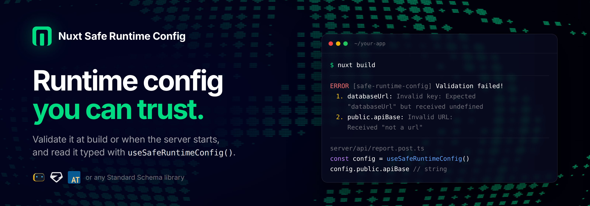

<p align="center">
  
</p>

<h1 align="center"> Nuxt Safe Runtime Config</h1>

<p align="center">
Validate Nuxt runtime config with <b>Valibot</b>, <b>Zod</b>, <b>ArkType</b> or an annotated <code>.env.example</code>, and read it through a typed composable.
</p>

<p align="center">
  <a href="https://nuxt-safe-runtime-config.onmax.me">Docs</a>
</p>

<p align="center">
  <a href="https://www.npmjs.com/package/nuxt-safe-runtime-config">
    
  </a>
  <a href="https://www.npmjs.com/package/nuxt-safe-runtime-config">
    
  </a>
  <a href="https://github.com/onmax/nuxt-safe-runtime-config/blob/main/LICENSE">
    
  </a>
  <a href="https://nuxt.com">
    
  </a>

  <p align="center">
    <a href="https://github.com/nuxt/nuxt/discussions/32301">
      🔗 Related Nuxt RFC: Enable Standard Schema Validation in Nuxt Config
    </a>
  </p>
</p>

> [!TIP]
> Nuxt 5 checks runtime config types itself. Point this module at a schema file and Nuxt types `useRuntimeConfig()` from it, while the module runs the URL formats, ranges, patterns and refinements Nuxt skips. See [Nuxt 5](https://nuxt-safe-runtime-config.onmax.me/guide/nuxt-5).

On Nuxt 4, `useRuntimeConfig()` returns whatever ends up in runtime config. Nothing checks that `NUXT_DATABASE_URL` is set or that `NUXT_PUBLIC_REPLAY_ENABLED=false` arrives as `false`. This module validates runtime config against a schema while you build and again when the server starts, and `useSafeRuntimeConfig()` returns the values typed from that schema.

## Quick start

```bash
npx nuxi module add nuxt-safe-runtime-config
```

```ts
// nuxt.config.ts
import * as v from 'valibot'

export default defineNuxtConfig({
  modules: ['nuxt-safe-runtime-config'],
  runtimeConfig: {
    databaseUrl: '',
    public: { apiBase: 'https://api.example.com', replayEnabled: false },
  },
  safeRuntimeConfig: {
    $schema: v.object({
      databaseUrl: v.pipe(v.string(), v.url()),
      public: v.object({
        apiBase: v.pipe(v.string(), v.url()),
        replayEnabled: v.boolean(),
      }),
    }),
  },
})
```

```ts
// server/api/report.post.ts
export default defineEventHandler((event) => {
  const config = useSafeRuntimeConfig(event)
  config.databaseUrl // string
  config.public.replayEnabled // boolean, also from NUXT_PUBLIC_REPLAY_ENABLED=false
})
```

If the server starts without a valid `NUXT_DATABASE_URL`, it stops before serving a request:

```txt
[safe-runtime-config] Runtime validation failed: #: Property "databaseUrl" does not match schema., #/databaseUrl: String does not match format "uri".
```

## What it does

- [Build or runtime validation](https://nuxt-safe-runtime-config.onmax.me/guide/validation) with any [Standard Schema](https://standardschema.dev/) library
- [Coercion of `NUXT_*` strings](https://nuxt-safe-runtime-config.onmax.me/guide/environment-overrides) to the booleans, numbers, enums and JSON values your schema expects, and schema modules for transforms
- [Generated types](https://nuxt-safe-runtime-config.onmax.me/guide/type-safety) for `useSafeRuntimeConfig()` in the app and in `server/`
- [`.env.example` as the schema](https://nuxt-safe-runtime-config.onmax.me/guide/env-schema) (experimental), so builds need no secrets
- An [ESLint rule](https://nuxt-safe-runtime-config.onmax.me/guide/eslint) that migrates `useRuntimeConfig()` calls
- A [Nitro module](https://nuxt-safe-runtime-config.onmax.me/guide/nitro) for Nitro apps without Nuxt

Supports Nuxt 4 and the Nuxt 5 nightly, on Nitro 2 and 3.

## Contribution

<details>
  <summary>Local development</summary>

```bash
# Install dependencies
pnpm install

# Generate type stubs
pnpm run dev:prepare

# Develop with the playground
pnpm run dev

# Build the playground
pnpm run dev:build

# Run ESLint
pnpm run lint

# Run Vitest
pnpm run test
pnpm run test:watch
```

Releases go through [uppt](https://github.com/danielroe/uppt). Every push to `main` updates a draft `release/vX.Y.Z` PR built from conventional commits. Merging it tags the version, creates the GitHub release, and publishes the package to npm through OIDC trusted publishing. If publishing fails after the tag exists, run `gh workflow run release.yml --ref vX.Y.Z`.

</details>
